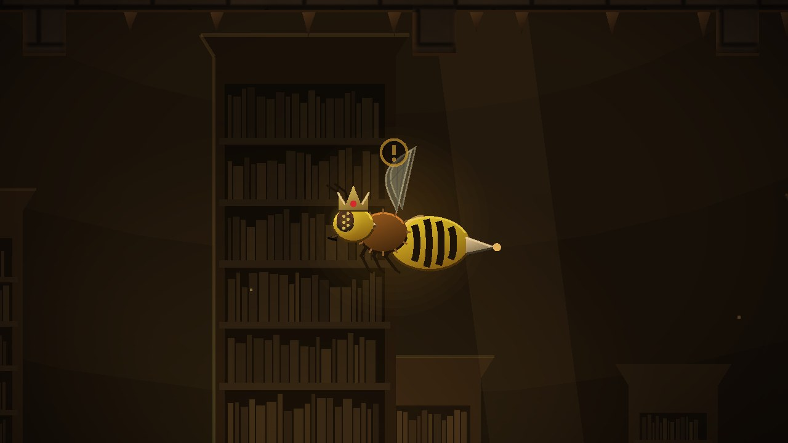

# Lanterne des Profondeurs (Laterne der Tiefe)

[English](README.md) · [Français](README.fr.md) · [Español](README.es.md) · **Deutsch**

2D-Roguelite-Metroidvania für **Godot 4.3+**, inspiriert von Hollow Knight: dunkle Höhlen,
Nadelkampf, Abprallen von Gegnern, Heilen mit Seele, Rastbänke und zehn Bosse.
Alles wird per Code gezeichnet: Das Spiel enthält kein einziges Bild.

**Im Browser spielen: https://flyinnrabbit.github.io/lanterne-des-profondeurs/**

## Screenshots

| | |
|---|---|
|  |  |
|  |  |
|  |  |
|  |  |
|  |  |
|  |  |
|  |  |
|  |  |

**Feste im Heiligtum** (Valentinstag, Ostern, Schattenwacht, Weihnachten)

**Ladebildschirme** (Start, Betreten eines Ladens, Aufzug)

| | | |
|---|---|---|
|  |  |  |

*Die Screenshots zeigen die englische Oberfläche; das Spiel gibt es auf Deutsch, Englisch, Französisch und Spanisch.*

## Herunterladen und spielen

Das Spiel ist auf Deutsch, Englisch, Französisch und Spanisch verfügbar.

### Browser (PC, Xbox, Tablet)
**https://flyinnrabbit.github.io/lanterne-des-profondeurs/** — wird bei jedem Push automatisch aktualisiert.
Tastatur, Maus und Controller funktionieren; Spielstände werden im Browser gespeichert.
- **Xbox Series**: **Microsoft Edge** öffnen, die Adresse oben aufrufen, Vollbild aktivieren.
- Beim ersten Laden werden etwa 55 MB heruntergeladen.
- Im Browser folgen die Tastennamen standardmäßig dem QWERTY-Layout: Wähle bei Bedarf unter
  **Steuerung → Tastatur** ein anderes Layout.

### Windows
Neueste Version: Reiter **Releases** → `LanterneDesProfondeurs_Windows.zip`, entpacken und
`LanterneDesProfondeurs.exe` starten. Die Datei ist nicht signiert: Windows SmartScreen kann
„Der Computer wurde durch Windows geschützt" anzeigen → *Weitere Informationen* → *Trotzdem ausführen*.

### macOS (Intel und Apple Silicon)
1. `LanterneDesProfondeurs_macOS.zip` aus dem Release herunterladen, entpacken und
   **Lanterne des Profondeurs** in den Programme-Ordner ziehen.
2. Die App ist nicht von Apple notarisiert (dafür wäre ein kostenpflichtiges Entwicklerkonto nötig),
   daher blockiert macOS sie beim ersten Start:
   - **Rechtsklick (oder Ctrl-Klick) auf die App → Öffnen**, dann im Dialog **Öffnen**;
   - unter **macOS 15 (Sequoia)** und neuer: die App einmal öffnen, dann **Systemeinstellungen →
     Datenschutz & Sicherheit** → ganz unten **„Dennoch öffnen"**;
   - meldet macOS, „die App ist beschädigt", öffne das **Terminal** und gib ein:
     `xattr -cr "/Applications/Lanterne des Profondeurs.app"`, dann die App erneut öffnen.
3. Danach startet das Spiel normal. Xbox- und PlayStation-Controller funktionieren.
   Spielstände: `~/Library/Application Support/Godot/app_userdata/Lanterne des Profondeurs/`.

### Linux und Steam Deck
In den Releases: `LanterneDesProfondeurs_Linux_SteamDeck.tar.gz` (Linux x86_64).

**Linux**: Archiv entpacken und `./LanterneDesProfondeurs.x86_64` starten
(falls nötig: Rechtsklick → Eigenschaften → „Als Programm ausführen erlauben" oder `chmod +x`).

**Steam Deck**:
1. In den **Desktop-Modus** wechseln (Steam-Taste → Ein/Aus → Zum Desktop wechseln).
2. Das Archiv im Browser von der Release-Seite herunterladen und entpacken
   (Rechtsklick → *Hier entpacken*), zum Beispiel nach `~/Games/Lanterne`.
3. Steam im Desktop-Modus öffnen → *Spiele* → **Ein Nicht-Steam-Spiel zu meiner Bibliothek hinzufügen**
   → *Durchsuchen* → `LanterneDesProfondeurs.x86_64` wählen → *Ausgewählte Programme hinzufügen*.
4. Zurück in den **Spielmodus**: Das Spiel steht in der Bibliothek (Reiter *Nicht-Steam*).
   Es startet im Vollbild, die Deck-Steuerung funktioniert sofort
   (A springen, X angreifen, RT Sprint, LB parieren, Y Ultimate, B heilen) und füllt den 16:10-Bildschirm.
   Das mitgelieferte Symbol `LanterneDesProfondeurs.png` kann in den Verknüpfungs-Eigenschaften gewählt werden.

### Portable Version
`LanterneDesProfondeurs_Windows_Portable.zip` / `LanterneDesProfondeurs_Linux_Portable.tar.gz`:
das Spiel mit einer Datei `portable.txt`. Solange diese Datei neben der ausführbaren Datei liegt,
werden Fortschritt, Einstellungen und Tasten im Spielordner `sauvegardes` gespeichert (sonst wird
nirgends etwas geschrieben): Kopiere den Ordner auf einen USB-Stick, um Spiel und Spielstand mitzunehmen.
Lösche `portable.txt`, um zum üblichen Speicherort zurückzukehren.

### Das Projekt in Godot öffnen
1. Godot 4 installieren (Standardversion, nicht .NET): https://godotengine.org/download
2. In der Projektverwaltung: **Importieren** → den Projektordner (die Datei `project.godot`) wählen.
3. **F5** drücken.

Selbst exportieren: *Editor → Exportvorlagen verwalten → Herunterladen und installieren*,
dann *Projekt → Exportieren* mit einem der mitgelieferten Profile (Windows Desktop, Linux, macOS, Web).

## Steuerung (Tastatur und Xbox-/XInput-Controller)

Tasten werden **nach ihrer Position** auf der Tastatur gespeichert: Auf QWERTY und QWERTZ bewegst du
dich mit **W A S D**, auf AZERTY mit **Z Q S D**, ganz ohne Einstellung. Die angezeigten Namen folgen
dem Layout des Systems; wird es falsch erkannt (virtuelle Maschine, Steam Deck …), wähle **Steuerung →
Tastatur: AZERTY / QWERTY / QWERTZ**. Die Tabelle verwendet die QWERTY-/QWERTZ-Namen.

| Aktion | Tastatur | Controller |
|---|---|---|
| Bewegen | A / D oder Pfeiltasten | Linker Stick / Steuerkreuz |
| Springen (halten = höher) | Leertaste | A |
| Angreifen | J oder **Linksklick** | X |
| Nach oben / unten angreifen | W oder S + J | oben/unten + X |
| Ducken (weicht hohen Angriffen aus) | S oder Pfeil unten (halten, am Boden) | unten |
| Sturzangriff (in der Luft) | S + K | unten + RT |
| Sprint / Ausweichen | K oder Umschalt | RT |
| Parieren | I oder **Rechtsklick** | LB |
| Seelenzauber (33 Seele) | O oder Mittelklick | RB |
| Ultimate (Leiste voll) | U oder R | Y |
| Heilen (halten, 33 Seele) | L oder F | B |
| Auf einer Bank rasten | W / Pfeil oben | oben |
| Karte | M | R3 |
| **Pause und Menü** | **Esc oder P** | **Menü (Start)** |
| **Inventar / Ausrüstung** | **Tab oder B** | **Ansicht (Back)** |

### Menü „Steuerung"
Esc → **Steuerung**: Klicke (oder bestätige mit dem Controller) auf ein Feld und drücke die neue Taste.
Jede Aktion hat 2 Tasten und 1 Controllertaste; ist die Taste schon belegt, werden die beiden Aktionen
getauscht. Entf löscht eine Taste, Esc bricht ab. Die Felder nehmen auch Maustasten an (links, rechts,
Mitte, Seitentasten). Menüs und Inventar lassen sich mit der Maus bedienen; im Spiel verschwindet der
Mauszeiger nach 2 Sekunden ohne Bewegung.
Die Einstellungen werden automatisch gespeichert (`user://controls.cfg`). Der linke Stick bewegt den Helden immer.

### Tastensymbole
Bildschirmhinweise, Schilder, Meldungen und das Steuerungsmenü zeigen **Symbole**: gezeichnete Tasten
und Maustasten für die Tastatur, farbige A/B/X/Y und LB/RT … für einen Xbox-Controller, und Kreuz /
Kreis / Quadrat / Dreieck, L1/R2 … für einen PlayStation-Controller (allgemeine Symbole).

### Controller (XInput)
Unter Windows liest Godot Xbox-Controller über XInput: einfach anschließen. Das Spiel zeigt den erkannten
Controller an, verwendet die Xbox-Tastennamen, akzeptiert die Trigger in Menüs und vibriert bei Treffern,
Schaden und Bossen. Die Vibration lässt sich im Steuerungsmenü abschalten. Die Bildschirmhinweise folgen
dem zuletzt benutzten Gerät (Tastatur oder Controller).

## Spielstände und Schwierigkeit

**3 Speicherplätze**: Titelbildschirm → „Spielstände". Jeder Platz hat seinen eigenen Spielstand und seine
eigene Schwierigkeit (zum Beispiel ein Normal- und ein Albtraum-Spiel). „Fortsetzen" lädt den zuletzt
gespielten Platz. Erfolge, Kosmetik und Optionen gelten für alle Plätze. Gespeichert wird automatisch.

Zum Start: **Spielen** → Schwierigkeit wählen (und die Option „Tutorial überspringen").
Auch während eines Spiels: Pause → „Neues Spiel …".

**Nur ein Leben** (Kästchen beim Erstellen des Spiels, in jeder Schwierigkeit): Der erste Tod löscht den
Speicherplatz (außerhalb des Tutorials). Ein kleiner Schädel neben den Splittern erinnert daran. Erfolge und
Kosmetik bleiben erhalten, da sie für alle Spielstände gelten.

| Schwierigkeit | Seele / Ultimate | Gegner | Erlittener Schaden |
|---|---|---|---|
| Leicht | +35 % / +30 % | langsamer, -25 % Leben, weniger zahlreich, keine Eliten | 1 |
| Normal | normal | normal; Eliten: 8 % am Anfang, bis 35 % in der Tiefe | 1 |
| Schwer | -25 % / -20 % | +25 % Tempo, aggressiver, +35 % Leben, +35 % Gegner; Eliten: 25 % bis 65 % | 1 |
| Albtraum | -40 % / -35 % | +40 % Tempo, sehr aggressiv, +60 % Leben, +60 % Gegner; Eliten: 42 % bis 85 % | **2** |

Auch die Bosse werden je nach Schwierigkeit schneller und zäher.

## Das Heiligtum und die endlosen Ebenen

Nach dem Tutorial erreichst du das **Heiligtum der Laterne**, das Herz des Spiels:
- **Bank**: rasten, Leben wiederherstellen, Embleme wechseln. In der Tiefe heilt jede Bank nur einmal pro
  Zone (du kannst dich erneut setzen, um den Wiedereinstiegspunkt zu setzen und Embleme zu wechseln),
  und nicht direkt nach einem Kampf (1,5 s).
- **Händler**: tauscht Splitter gegen **Lebensmasken** (+1 maximales Leben, bis zu 4), Emblem-**Kerben**
  und die **Embleme**, die du noch nicht gefunden hast.
- **Arsenal**: deine Grundwaffe kaufen und ausrüsten. **Ausprobieren** leiht eine Waffe, solange du im Heiligtum bleibst.
- **Trainingspuppe** (rechts vom Arsenal): zeigt deinen Schaden pro Sekunde.
- **Schneiderin** (links von der Bank): Garderobe und Kosmetik.
- **Aufzug**: wähle die **Ebene**, in die du hinabsteigst.
- Mit jeder geschafften Ebene kommen **Bewohner** dazu: die **Schmiedin** (Ebene 1, schmiedet deine Waffen auf Stufe 2), der
  **Kartograf** (Ebene 2, verkauft eine Feder, die die ganze Karte aufdeckt) und der **Älteste**
  (Ebene 3, die Geschichte der Laterne).

Dein Leben bleibt beim Portal zwischen den beiden Zonen einer Ebene erhalten (Leicht und Normal geben
1 Maske zurück, Schwer und Albtraum nichts).

Eine **Ebene = 2 generierte Zonen** (Biome zufällig aus 9) **und dann ein Boss**. Schaffst du sie, kehrst du
ins Heiligtum zurück und **schaltest die nächste Ebene frei**, ohne Ende. Je tiefer du steigst, desto mehr
Leben, Tempo, Aggressivität und Eliten haben die Gegner (etwa ×1,9 Leben auf Ebene 6, ×2,6 auf Ebene 10).

**Stirbst** du während eines Abstiegs, kehrst du ins Heiligtum zurück und verlierst die seit dem Aufbruch
gesammelte Beute (Splitter, Embleme, Kerben); freigeschaltete Ebenen und Käufe bleiben erhalten. Dein
**Schatten** bewahrt die verlorenen Splitter dort, wo du gefallen bist: Kehre in dieselbe Ebene zurück und
besiege ihn, um sie zurückzuholen (ein neuer Tod ersetzt ihn).

Vom Aufzug aus kannst du außerdem:
- jede Ebene mit einem **Fluch** spielen (Eile, Dunkelheit, Zerbrechlichkeit) für +50 bis 60 % Splitter;
- den **Abstieg des Tages** spielen (dieselbe Ebene für alle, Bestzeit);
- nach Ebene 6 die **Boss-Herausforderung** annehmen (Bosse nacheinander, mit Zeitmessung).

Es gibt 29 **Erfolge**, einsehbar über den Titelbildschirm oder das Pausenmenü.

### Die 9 Biome

| Biom | Merkmale |
|---|---|
| Die Tiefen | bläuliche Höhlen, Hügel und Schächte, Kriecher und Flieger |
| Die Pilzgärten | Wände zum Erklimmen, Schächte, viele Spucker |
| Die Versunkene Zitadelle | Säulen über Stacheln, Arenen, Brücken |
| Die Kristallminen | große Abgründe (Sprint), niedrige Gänge, Flieger |
| Die Glühende Schmiede | überall Stacheln, Glut, viele Kriecher |
| Die Stille Bibliothek | Klettern und Plattformen, Fliegerschwärme |
| Der Eisige Abgrund | Schnee, brüchige Brücken und Abgründe, Spucker |
| Der Summende Stock | enge Gänge voller Flieger |
| Das Beinhaus | Hügel und Arenen, Kriecher und Spucker |

### Besondere Räume
- **Schatz**: Ein rissiger Boden verbirgt eine Truhe; zerschlage ihn (Schläge nach unten oder Sturzangriff).
- **Zeitprüfung**: Berühre die Sanduhr-Spur und erreiche die Flagge in 13 Sekunden.
- **Elite-Arena**: Wecke den Altar, besiege drei Eliten und gewinne Splitter und ein Emblem.
- **Fahrender Händler**: manchmal nahe der Bank in der Zonenmitte (Käufe zählen als Beute).

### Fallen und Plattformen
Die Zonen haben Relief (der Boden steigt und fällt von Raum zu Raum) und abwechslungsreiche Räume:
schwebende Inseln, Zickzack-Schächte, Doppelwege, niedrige Höhlen, brüchige Brücken, Abgründe mit
beweglicher Plattform, Klingengänge.
- **Pfeiltotem**: schießt auf Kopfhöhe — ducken, springen oder parieren. Nie nahe einer Boss-Arena.
- **Pendelklinge**: Ihr tiefster Punkt geht knapp über einen geduckten Helden hinweg.
- **Stalaktit**: fällt, wenn du darunter hindurchgehst.
- **Brüchige Blöcke**: geben kurz nach dem Betreten nach und bauen sich dann wieder auf.
- **Bewegliche Plattform**: pendelt über einem Abgrund hin und her.
- Fallen erscheinen in höchstens 50 % der Räume, und Fallenräume haben weniger Gegner.

## Kampf

- **Bodenkombo**: drei Schläge; der 3. ist ein breiterer, stärkerer **Abschlussschlag**.
- **Aufgeladener Schlag**: Angriff etwa 0,7 s halten (die Nadel leuchtet) und loslassen = ein **Wirbel**,
  der rundum trifft.
- **Ausfall**: greife **während (oder direkt nach) einem Sprint** an = ein durchbohrender Stoß in gerader Linie.
- **Luftkombo** (anders als am Boden): Hieb, **Aufwärtshieb**, der dich wieder anhebt, und eine
  **Drehung**, die rundum trifft.
- **Sturzangriff**: in der Luft unten + Sprint. Du stürzt hinab, prallst vom getroffenen Gegner ab oder
  löst bei der Landung eine **Schockwelle** aus. Einer pro Sprung. Nach einem Sturzangriff landest du
  stehend: Erst nach dem Loslassen von unten duckst du dich wieder.
- **Ducken**: unten am Boden halten. Langsamer, aber hohe Angriffe gehen darüber hinweg (Ausfall des
  Lanzenträgers, Schwung des Kolosses, Pfeile, Pendelklingen). Geduckt angreifen = tiefer Schlag.
- **Seelenzauber**: eine nach vorn geschleuderte Seelenklinge, die Gegner **durchdringt** (kostet 33 Seele,
  genauso viel wie eine Heilung: Du entscheidest).
- **Parieren**: ein kurzes Fenster (0,2 s). Ein parierter Kontakt betäubt den Gegner; ein parierter Boss ist
  eine Sekunde betäubt. Eine parierte Spore fliegt zurück zu den Gegnern. Gibt Seele und viel Ultimate-Ladung.
- **Perfekte Parade**: Pariere im letzten Moment und es erscheint „PERFEKT!"; ein **goldenes Licht** leuchtet
  an der Waffenspitze, und der nächste Treffer ist **kritisch: Schaden ×1,5** (aufgerundet, immer mindestens +1).
- **Ausweichen**: Während des Sprints gehst du durch Gegner und Geschosse hindurch (nicht durch Stacheln).
- **Ultimate**: Die goldene Leiste füllt sich durch Treffer (+6) und Paraden (+25). Ist sie voll, bleibt der
  Held stehen, lädt eine halbe Sekunde auf (unverwundbar) und entfesselt eine Schockwelle: 8 Schaden an
  allem in der Nähe, Sporen werden zerstört.
- Ein Nadeltreffer zerstört auch gegnerische Sporen.
- **Rückstoß**: Jeder Treffer schiebt den Helden ein wenig zurück (etwa 9 px bei den ersten beiden
  Kombo-Schlägen, 24 px beim Abschlussschlag, nichts geduckt): Die ganze Kombo trifft ein stillstehendes Ziel.
- **Angriffswarnungen**: ein gelbes „!" über einem Gegner, der einen Schlag vorbereitet; orange mit Pfeil
  bei einem hohen Angriff (ducken).

### Das Arsenal

| Waffe | Preis | Stil | Stufe 2 (Schmiedin) |
|---|---|---|---|
| Nadel des Wächters | — | ausgewogen | der Abschlussschlag schleudert eine kurze Luftklinge |
| Dornenpeitsche | 150 | sehr große Reichweite nach vorn und oben, etwas langsamer | zieht kleine Gegner heran |
| Ambosshammer | 220 | langsam, +1 Schaden, starker Rückstoß, betäubt | der Abschlussschlag sendet zu beiden Seiten eine Schockwelle (steigt Stufen hinauf) |
| Mondsterne (Shuriken) | 260 | Fernkampf; Abschluss = 3 Sterne, Wirbel = 8 im Kreis, Ausfall = ein großer durchbohrender Stern | kehren wie ein Bumerang zurück und treffen erneut |

Mondsterne: höchstens 3 einfache Sterne gleichzeitig auf dem Bildschirm, weniger Seele pro Treffer, und
Bosse erleiden nur 75 % des Fernkampfschadens.

### Embleme
Tab öffnet das Inventar (das Spiel pausiert): Gegenstände, Splitter, Statistiken und das Raster der
**Embleme**, die in den Zonen zu finden sind. Jedes Emblem kostet Kerben; du beginnst mit 3 und kannst
weitere finden (goldene Ringe) oder kaufen. Die Ausrüstung lässt sich nur **auf einer Bank sitzend** ändern.

| Emblem | Kosten | Wirkung |
|---|---|---|
| Lange Nadel | 2 | Reichweite der Schläge +40 % |
| Kristallherz | 2 | +2 Lebensmasken |
| Flinker Umhang | 1 | Laufen +12 %, Sprint lädt doppelt so schnell nach |
| Dornenpanzer | 2 | Dornen verletzen nahe Gegner, wenn du getroffen wirst |
| Perfekter Spiegel | 1 | Paradefenster 0,35 s |
| Gierige Seele | 2 | mehr Seele und Ultimate bei jedem Treffer |
| Lebendige Sammlung | 1 | Heilung fast doppelt so schnell |
| Rohe Kraft | 3 | +1 Schaden, aber Schläge 20 % langsamer |
| Glühender Meteor | 2 | ein treffender Sturzangriff bereitet einen kritischen Treffer vor |
| Ruhe des Schattens | 2 | geduckt außerhalb des Kampfes steigt die Seele langsam bis 33; geduckt heilen 1,5× schneller |
| Perfektes Echo | 2 | eine perfekte Parade schleudert gratis eine Seelenklinge |
| Leichter Schritt | 1 | eine Falle ungetroffen passieren gibt 5 Splitter |

Die Wirkungen sind in `scripts/charms.gd` definiert und werden in `scripts/player.gd` angewendet.

## Gegner
- **Kriecher**, **Flieger**, **Spucker**: die Grundlagen — läuft, stürzt herab, spuckt Sporen.
- **Springer**: eine Heuschrecke, die auf dich springt.
- **Schildwache**: blockt Schläge von vorn. Triff sie von oben, von hinten oder mit dem Ultimate.
- **Sprengknolle**: rollt auf dich zu, leuchtet auf und explodiert (verletzt auch nahe Gegner).
- **Weberin**: eine an der Decke hängende Spinne, die herabfällt, wenn du darunter gehst.
- **Lanzenträger**: geht in Stellung und führt einen langen Ausfall aus; eine Parade betäubt ihn.
- **Geist**: verblasst (unberührbar), taucht neben dir wieder auf und schleudert eine langsame Kugel.
- **Eliten** (rotes Leuchten): mehr Leben, schneller, doppelte Beute und ein Zusatzangriff — der Kriecher
  stürmt, der Flieger stürzt herab, der Spucker spuckt 3 Sporen, der Springer springt zweimal hintereinander,
  die Wache stürmt mit ihrem Schild.

Kein Gegner kann durch eine Wand treffen. Zähe Gegner und Eliten werden häufiger, je tiefer du kommst.

## Bosse

Der Wächter ist immer der erste; die fünf anderen kommen in einer **für jedes Spiel eigenen Reihenfolge**,
dann beginnt der Zyklus von vorn, schwerer. Jeder hat seine Gestalt, seine Angriffe, eine **Phase 2** bei
halbem Leben und sein eigenes Thema. Einen Kontakt zu parieren betäubt den Boss für eine Sekunde.

| Boss | Stil | Angriffe |
|---|---|---|
| Wächter des Schachts | gepanzerter Käfer | angekündigter Ansturm, Stampfsprung; Phase 2: Schockwellen am Boden |
| Die Versunkene Äbtissin | Sporenkönigin | Ansturm, Sprung, Fächersalve, Sporenring (dichter in Phase 2) |
| Die Schwarmkönigin | **fliegende** Riesenwespe | Sturzflüge (verkettet in Phase 2), gezielte Stachelsalve, Spiralringe, ruft Flieger |
| Der Knochenkoloss | Knochenriese | Bodenschlag (Wellen + Steinschlag), Armschwung; Phase 2: Sprung + Reihe von Knochensäulen |
| Der Wurm der Tiefe | **grabender** Wurm | taucht ab, eine Staubspur verrät ihn, bricht unter dir hervor und spuckt Säure; Ansturm; Phase 2: drei Stürme aus dem Boden + Wellen |
| Der Geisterritter | Geisterduellant | Blitzausfälle (Dreierkombos in Phase 2), **teleportiert sich hinter dich**, Geistersäulen in Reihe, Glutsalve |

### Endbosse
Auf Ebene 7 (und dann alle 7 Ebenen) ein Endboss, **in jedem Spiel zufällig gewählt**, jeder mit eigenem Thema:
- **Der Schatten der Laterne**: Glutkränze, Schwung auf Kopfhöhe, Ascheregen, Lichtsäulen, Geister in Phase 2.
- **Der Zerberus der Tiefe**: Glutatem aus drei Köpfen, Sprung mit Schockwelle, dreifacher Biss auf
  Kopfhöhe (ducken), ein Heulen, das Flammen aufschießen lässt.
- **Der Zentaurenschütze**: galoppiert durch die Arena, Pfeilsalven, am Boden markierter Pfeilregen,
  Lanzenstoß auf Kopfhöhe (ducken), springt über den Spieler.
- **Das Auge von Unten**: Tentakel aus dem Boden, ein Strahl, der die Arena auf Kopfhöhe (ducken) oder
  am Boden (springen) überstreicht, Sporenspiralen, fliegende Augen.

Sein Sieg löst **das Ende** aus: Die Laterne entflammt neu, das Licht steigt Ebene um Ebene bis zum Heiligtum
und dann an die Oberfläche, und der Abspann läuft. Danach gehen die Ebenen weiter.
Erfolg „Die vier Wächter": alle vier besiegen.

## Grafik

Alles wird per Code gezeichnet, in einem detaillierten, gemalten Stil:

- **Fels**, texturiert von einem eigenen Shader pro Biom (Schichten, Quader, Kristall, Lavaadern, Eis,
  Waben, Knochen), dunkler in der Tiefe, mit beleuchteten Kanten;
- **verzierte Böden** je nach Biom (Gras, leuchtende Pilze, Kristalle, Schädel, Bücher, Kerzen, Schnee,
  Honig) und **Parallax-Hintergründe** in drei Ebenen mit Nebel und Lichtstrahlen;
- **Held, Gegner, 10 Bosse und Bewohner des Heiligtums** mit Schattierung, Glanzlichtern und Details;
- **Fallen, Gitter, Angriffssäulen, Ausgangsportal** (ein Design pro Biom) und **das Ende**;
- **Embleme**: jedes hat sein graviertes Medaillon und sein Symbol; **Waffenschläge** hinterlassen gemalte Spuren;
- **Oberfläche**: gläserne Seelenflasche mit Messingring, gemalte Masken, Ultimate-Leiste aus Messing,
  facettierter Splitterkristall und Pergament-Minikarte;
- **Menüs und Titelbildschirm**: gemalter Hintergrund (Schacht, Laterne, Glut), Tafeln aus dunklem Holz und Messing;
- **Kampfeffekte**: Trefferstern, Todesring mit Rauch und Trümmern, Splitter, die zum Helden fliegen,
  Landestaub, Sprint-Nachbild, Geschosse mit Schweif;
- **Atmosphäre pro Biom**: Sporen und Glühwürmchen, Schnee, fliegende Seiten, Glut, Irrlichter, tropfende
  Decken, brodelnde Lava, leuchtende Kristallgruppen;
- **Karte**, gezeichnet wie eine verlorene Karte: zerrissenes, gefaltetes, fleckiges und angesengtes Pergament.

## Karte, Optionen und Barrierefreiheit
- **Karte** (M / R3): alles Entdeckte der Zone, mit einem Piktogramm und einer Legende für jeden gefundenen
  Ort (Bank, Ausgang, Händler, Bewohner, Truhen, Embleme, Altar, Prüfung, Schatten …).
  **Minikarte** oben rechts (Optionen).
- **Sprache**: Automatisch (Systemsprache), Français, English, Español, Deutsch.
  Die Übersetzungen liegen in `tools/translations.py`; `python3 tools/translations.py` erzeugt
  `scripts/translations.gd` neu.
- **Größe der Oberfläche** (60–160 %) und **der Menüs** (60–130 %), **Kamerazoom**,
  **Vollbild** (auch F11), **vertikale Synchronisation**.
- **Lebensleisten der Gegner** und **verursachter Schaden**, kurz oben rechts angezeigt.
- **Bildschirmhinweise**, **Bildschirmwackeln** (0–150 %), **Trefferstopp**, **Controller-Vibration**.
- **Barrierefreiheit**: kontrastreiche Gefahren (Farbenblindheit), Ducken als Umschalter,
  Spieltempo 100 / 90 / 80 / 70 %.
- **Abstiegsstatistik** (Gegner, Schaden, kritische Treffer, perfekte Paraden, erlittene Treffer, Zeit),
  angezeigt bei der Rückkehr ins Heiligtum.

Alles wird in `user://settings.cfg` gespeichert.

## Kosmetik und Garderobe
Die **Schneiderin** im Heiligtum (links von der Bank) öffnet die Garderobe, in der du das Aussehen des
Helden mit animierter Vorschau änderst: **53 Kosmetikartikel** in 6 Kategorien, davon 21 saisonale.
Alles ist rein optisch und gilt für alle Speicherplätze. Helle Umhänge sind abgedunkelt, damit sie auf
dunklen Hintergründen nicht blenden.

| Kategorie | Beispiele |
|---|---|
| Umhang | Schatten, Glut, Moos, Frost, Amethyst, Elfenbein, Goldener Wächter, Sternennacht |
| Schal | Türkis, Scharlach, Gold, Weiß, Violett, Lebendige Glut |
| Kopfschmuck | Rabenfeder, Kerze, Blumenkranz, Goldkrone, Heiligenschein, Knochenhörner |
| Spur und Glanz | Farbe von Sprint, Auge und Schlägen: Glut, Frost, Geist, Reines Gold … |
| Begleiter | Glühwürmchen, Motte, Irrlicht, kleine Laterne, Wespe der Königin (folgt dem Helden, rein dekorativ) |
| Ultimate | Aussehen der Schockwelle: Goldwelle, Frostnova, Freudenfeuer, Finsternis, Geisterschwarm |

Drei Wege, sie zu bekommen:
- bei der Schneiderin mit Splittern **kaufen** (die häufigsten);
- einen **Erfolg** erringen: Die Belohnung steht in der Erfolgsliste;
- einen **Boss besiegen**: Koloss, Königin, Ritter, Zerberus und Auge haben je einen seltenen Kosmetikartikel
  (25 % Chance pro Sieg).

Es gibt **29 Erfolge**, von denen mehrere Kosmetik geben, darunter „Kalender des Wächters": das Geschenk
aller vier Feste öffnen.

### Feste
Vier Feste kehren jedes Jahr automatisch nach dem Datum wieder. Während jedes Festes wird das Heiligtum
geschmückt, einmal im Jahr lässt sich ein **Geschenk** öffnen (der Kopfschmuck des Festes und 50 Splitter),
und die Schneiderin verkauft die Festkollektion. Was du gewinnst oder kaufst, bleibt das ganze Jahr.

| Fest | Daten | Geschenk | Im Verkauf |
|---|---|---|---|
| Valentinstag | 8. – 16. Februar | Herzdiadem | Rosenumhang, Spur Pochendes Herz, Herzchen, Ultimate Liebespfeil |
| Ostern | eine Woche vor bis eine Woche nach | Hasenohren | Frühlingsumhang, Küken, Ultimate Schlüpfen |
| Schattenwacht | 20. Oktober – 2. November | geschnitzter Kürbis | Wachtumhang, Kürbisfeuer, Fledermaus, Ultimate Fledermauswolke |
| Weihnachten | 1. Dezember – 6. Januar | Weihnachtsmütze | Weihnachtsumhang, Lichterkette, Rentiergeweih, Schneeflocken, lebende Flocke, Ultimate Weihnachtsstern |

Jedes Fest hat seine eigene **Musik** im Heiligtum und auf dem Titelbildschirm, für das Spiel komponiert
von `tools/synth_fetes.py` (dieselben Instrumente wie der Rest des Soundtracks, keine existierende Melodie).

Ein Fest außerhalb der Saison testen: das Spiel mit der Umgebungsvariable
`LANTERNE_EVENT=noel` starten (oder `halloween`, `valentin`, `paques`).

## Ladebildschirme
Alle per Code gezeichnet, im Stil des Spiels; jede Taste beschleunigt sie.
- **Start**: In der Dunkelheit entzündet sich eine Laterne, Glut steigt auf, Titel und ein Tipp erscheinen,
  und eine Reihe aufglühender Glutstücke dient als Fortschrittsanzeige, begleitet vom Knistern der Glut
  (vom Spiel synthetisiert).
- **Betreten eines Ladens**: Zwei messingbeschlagene Holzflügel schließen sich über dem Schild des Bewohners
  (Beutel, Amboss, Karte und Feder, Schriftrolle, Garnrolle, gekreuzte Klingen) und öffnen sich zur Theke.
- **Aufzug**: Der Käfig mit dem Helden in seinem Outfit fährt durch einen Steinschacht hinab, während die
  Ketten rasseln; die Nummer der Ebene ist in eine Messingplatte unter dem Käfig graviert. Die Zone wird
  während der Fahrt gebaut, und der Käfig hält mit einem dumpfen Schlag. Nach einer geschafften Ebene fährt
  er zurück ins Heiligtum. Die Ketten sind eine lizenzfreie Aufnahme (`sfx/lift_chains.ogg`).

## Automatische Updates
Beim Start fragt das Spiel (Windows, macOS, Linux, Steam Deck) bei GitHub das neueste Release ab.
Ist es neuer:
- wird ein kleiner **Patch** (Skripte und Shader, einige Hundert KB) heruntergeladen und beim nächsten Start
  angewendet — der Titelbildschirm bietet **„Update bereit — neu starten"** an;
- reicht der Patch nicht (neue Musik, neue Godot-Version), zeigt der Titelbildschirm
  **„Version verfügbar — herunterladen"** und öffnet die Release-Seite.

Die Versionsnummer steht unten auf dem Titelbildschirm. **Optionen → Automatische Updates** schaltet das
Herunterladen ab (der Hinweis erscheint weiterhin). Ohne Netz passiert nichts. Startet das Spiel mit einem
Patch nicht richtig, wird dieser beim nächsten Start entfernt. Die Browserversion ist immer aktuell.
Details: `scripts/updater.gd`; der Patch wird vom Release-Workflow erzeugt (Exportprofil „Patch").
Erhöhe `config/data_gen` in `project.godot`, wenn du Musik, Sounds oder Bilder hinzufügst: Ältere
Installationen sehen dann den Download-Hinweis.

## Musik und Sounds
Ein **eigener**, für das Spiel erzeugter Soundtrack (lizenzfrei): 29 Loops in `music/` — ein oder zwei
pro Biom, die überblendet ineinander übergehen, ein Thema pro Boss, eines für das Tutorial, eines für das
Heiligtum und eines pro Fest. Die Soundeffekte liegen in `sfx/`, mit eigenen Klängen für jede Waffe,
für kritische Treffer und für die perfekte Parade. Lautstärken **Gesamt / Musik / Effekte** in den
Optionen; die Musik wird leiser, wenn das Spiel pausiert.

## Modding
- Handgebaute Karten liegen in `scripts/levels.gd`: Füge `LEVELS` einen Eintrag hinzu, um eine Zone zu
  erstellen (`#` Fels, `^` Stacheln, `c`/`f`/`s` Gegner, `B` Bank, `D` Kugel, `K` Boss …).
- Die Werte des Helden (Tempo, Sprung, Sprint, Schaden, Rückstoß) sind die Konstanten am Anfang von
  `scripts/player.gd`.

## Tests
`tests/test_run.gd` durchläuft die Zonen automatisch (simulierte Eingaben, Bosse, Menüs):
`godot --headless --fixed-fps 120 -s res://tests/test_run.gd`.
`tests/dump_maps.gd` erzeugt Hunderte Zonen, um zu prüfen, dass alle schaffbar sind.

## Lizenz
Code, Musik (für das Spiel erzeugt) und Soundeffekte: **MIT**-Lizenz — siehe `LICENSE`.
Ausnahme: `sfx/lift_chains.ogg` stammt aus der Aufnahme *Chains Chiming* von freesound_community auf Pixabay (Pixabay Content License, frei nutzbar, keine Namensnennung nötig).
Das Spiel ist von Hollow Knight (Team Cherry) inspiriert, verwendet aber weder dessen Figuren noch dessen Assets.
