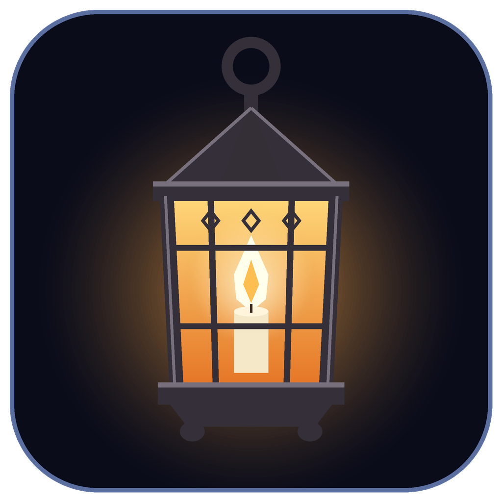
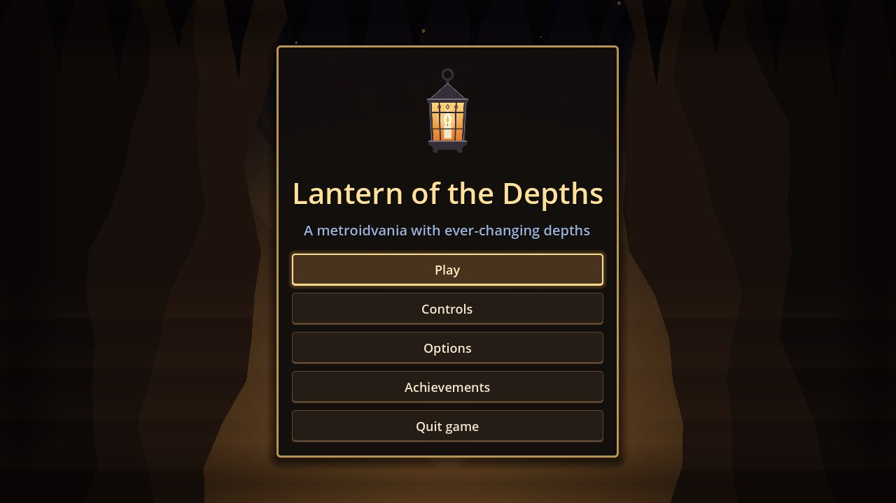
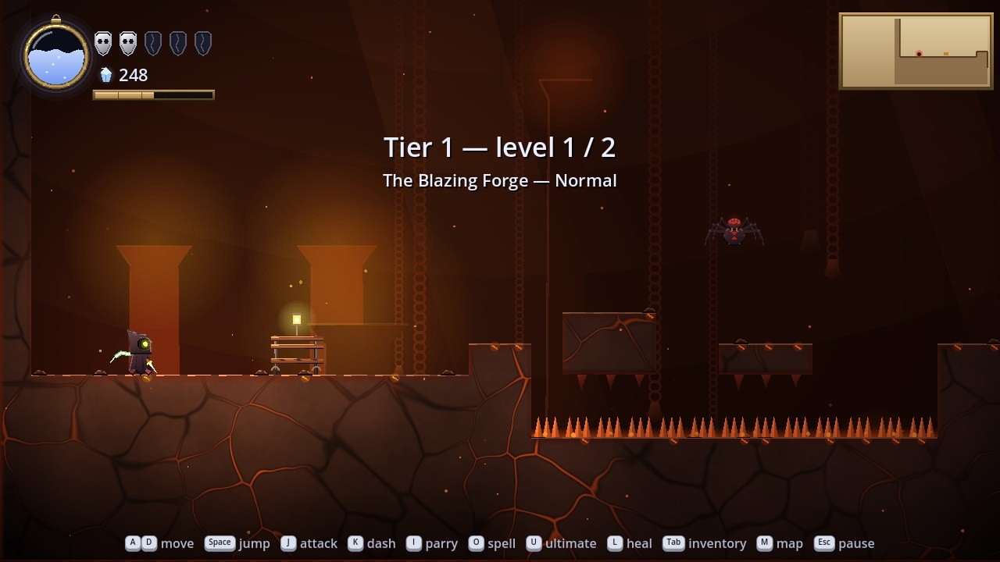
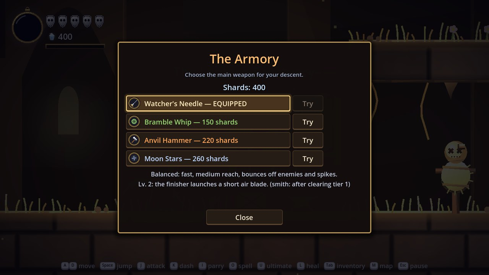

# Lanterne des Profondeurs (Lantern of the Depths)

*[Version française](README.fr.md)*

A 2D roguelite metroidvania for **Godot 4.3+**, inspired by Hollow Knight: dark caves, needle
combat, pogo jumps on enemies, healing with soul, resting benches and ten bosses.
Everything is drawn in code — there is not a single image asset in the game.

**Play in your browser: https://flyinnrabbit.github.io/lanterne-des-profondeurs/**

## Screenshots

| | |
|---|---|
|  |  |
|  |  |
|  |  |
|  |  |
|  |  |
|  |  |

## Download and play

The game is available in French, English, Spanish and German.

### Browser (PC, Xbox, tablet)
**https://flyinnrabbit.github.io/lanterne-des-profondeurs/** — updated automatically on every push.
Keyboard, mouse and gamepad all work; saves are kept in the browser.
- **Xbox Series**: open **Microsoft Edge**, go to the address above, then switch to full screen.
- The first load downloads about 55 MB.
- In the browser, key names follow the QWERTY layout by default: pick AZERTY in
  **Controls → Keyboard** if needed.

### Windows
Latest version: **Releases** tab → `LanterneDesProfondeurs_Windows.zip`, unzip it, run
`LanterneDesProfondeurs.exe`. The exe is not signed, so Windows SmartScreen may show
"Windows protected your PC" → *More info* → *Run anyway*.

### macOS (Intel and Apple Silicon)
1. Download `LanterneDesProfondeurs_macOS.zip` from the Release, unzip it and drag
   **Lanterne des Profondeurs** into the Applications folder.
2. The app is not notarised by Apple (that needs a paid developer account), so macOS blocks it on
   first launch:
   - **right-click (or Ctrl + click) the app → Open**, then **Open** in the dialog;
   - on **macOS 15 (Sequoia)** and later: launch the app once, then **System Settings →
     Privacy & Security** → at the bottom, **"Open Anyway"**;
   - if macOS says "the app is damaged", open **Terminal** and type:
     `xattr -cr "/Applications/Lanterne des Profondeurs.app"`, then launch it again.
3. After that the game starts normally. Xbox and PlayStation controllers work.
   Saves: `~/Library/Application Support/Godot/app_userdata/Lanterne des Profondeurs/`.

### Linux and Steam Deck
In the Releases: `LanterneDesProfondeurs_Linux_SteamDeck.tar.gz` (Linux x86_64).

**Linux**: extract the archive, then run `./LanterneDesProfondeurs.x86_64`
(if needed: right-click → Properties → "Allow executing", or `chmod +x`).

**Steam Deck**:
1. Switch to **Desktop Mode** (Steam button → Power → Switch to Desktop).
2. Download the archive from the Releases page with the browser and extract it
   (right-click → *Extract archive here*), for example into `~/Games/Lanterne`.
3. Open Steam in Desktop Mode → *Games* → **Add a Non-Steam Game to My Library**
   → *Browse* → pick `LanterneDesProfondeurs.x86_64` → *Add Selected Programs*.
4. Go back to **Gaming Mode**: the game is in the library (*Non-Steam* tab).
   It starts in full screen, the Deck controls work straight away
   (A jump, X attack, RT dash, LB parry, Y ultimate, B heal) and the 16:10 screen is filled.
   The supplied `LanterneDesProfondeurs.png` icon can be chosen in the shortcut's properties.

### Portable version
`LanterneDesProfondeurs_Windows_Portable.zip` / `LanterneDesProfondeurs_Linux_Portable.tar.gz`:
the game with a `portable.txt` file. As long as that file sits next to the executable,
progress, settings and key bindings are saved in the game's own `sauvegardes` folder
(nothing is written anywhere else): copy the folder to a USB stick to take the game and your
save with you. Delete `portable.txt` to go back to the usual save location.

### Run the project in Godot
1. Install Godot 4 (standard version, not .NET): https://godotengine.org/download
2. In the project manager: **Import** → choose the project folder (the `project.godot` file).
3. Press **F5**.

To build it yourself: *Editor → Manage Export Templates → Download and Install*, then
*Project → Export* and pick one of the presets already in the repo (Windows Desktop, Linux, macOS, Web).

## Controls (keyboard and Xbox / XInput gamepad)

Keys are stored **by position** on the keyboard: you move with **W A S D** on QWERTY and QWERTZ,
and with **Z Q S D** on AZERTY, with nothing to configure. The names shown on screen follow the
system layout; if it is detected wrongly (virtual machine, Steam Deck…), choose
**Controls → Keyboard: AZERTY / QWERTY / QWERTZ**. The table uses QWERTY names.

| Action | Keyboard | Gamepad |
|---|---|---|
| Move | A / D or arrow keys | Left stick / D-pad |
| Jump (hold = higher) | Space | A |
| Attack | J or **left click** | X |
| Attack upwards / downwards | W or S + J | up/down + X |
| Crouch (dodges high attacks) | S or down arrow (hold, on the ground) | down |
| Dive attack (in the air) | S + K | down + RT |
| Dash / dodge | K or Shift | RT |
| Parry | I or **right click** | LB |
| Soul spell (33 soul) | O or middle click | RB |
| Ultimate (full gauge) | U or R | Y |
| Heal (hold, costs 33 soul) | L or F | B |
| Rest on a bench | W / up arrow | up |
| Map | M | R3 |
| **Pause and menu** | **Esc or P** | **Menu (Start)** |
| **Inventory / equipment** | **Tab or B** | **View (Back)** |

### "Controls" menu
Esc → **Controls**: click (or confirm with the gamepad) a slot, then press the new key.
Each action has 2 keyboard keys and 1 gamepad button; if the input is already used, the two
actions are swapped. Delete clears a keyboard key, Esc cancels. Key slots also accept mouse
buttons (left, right, middle, side buttons). Menus and the inventory can be driven with the
mouse; in game, the cursor hides after 2 seconds without moving.
Settings are saved automatically (`user://controls.cfg`). The left stick always moves the hero.

### Control icons
On-screen hints, signs, messages and the Controls menu show **icons**: drawn keys and mouse
buttons for the keyboard, coloured A/B/X/Y, LB/RT… for an Xbox controller, and cross / circle /
square / triangle, L1/R2… for a PlayStation controller (generic symbols).

### Gamepad (XInput)
On Windows, Godot reads Xbox controllers through XInput: just plug one in. The game shows the
detected controller, uses Xbox button names, accepts triggers in the menu and rumbles on hits,
damage and bosses. Rumble can be turned off in the Controls menu. On-screen hints follow the
last device used (keyboard or gamepad).

## Saves and difficulty

**3 save slots**: title screen → "Saves". Each slot has its own game and its own difficulty
(for example a Normal game and a Nightmare game side by side). "Continue" resumes the last slot
played. Achievements and options are shared by all slots. Saving is automatic.

On launch: **Play** → choose the difficulty (and the "Skip the tutorial" option).
Also available during a game: Pause → "New game…".

| Difficulty | Soul / ultimate | Enemies | Damage taken |
|---|---|---|---|
| Easy | +35% / +30% | slower, -25% health, fewer, no elites | 1 |
| Normal | normal | normal, a few elites | 1 |
| Hard | -25% / -20% | +25% speed, more aggressive, +35% health, +35% enemies, 30% elites | 1 |
| Nightmare | -40% / -35% | +40% speed, very aggressive, +60% health, +60% enemies, 50% elites | **2** |

Bosses are also faster and tougher depending on the difficulty.

## The Sanctuary and the endless tiers

After the tutorial you arrive at **The Lantern Sanctuary**, the hub of the game:
- **Bench**: rest, restore health, change charms.
- **Merchant**: trades shards for **health masks** (+1 max health, up to 4), charm **notches**
  and the **charms** you have not found yet.
- **Arsenal**: buy and equip your base weapon. **Try** lends a weapon while you stay in the Sanctuary.
- **Training dummy** (right of the arsenal): shows your damage per second.
- **Elevator**: choose the **tier** to descend to.
- **Residents** arrive as you clear tiers: the **smith** (tier 1, level 2 weapons), the
  **cartographer** (tier 2, sells a quill that reveals the whole map) and the **elder**
  (tier 3, the story of the Lantern).

A **tier = 2 generated levels** (biomes drawn at random from 9) **then a boss**. Clearing it
brings you back to the Sanctuary and **unlocks the next tier** — endlessly. The deeper you go,
the more health, speed, aggression and elites the enemies have (about ×1.9 health at tier 6,
×2.6 at tier 10).

**Dying** during a descent: back to the Sanctuary, and the loot picked up since you left
(shards, charms, notches) is lost, but unlocked tiers and purchases remain. Your **shade** keeps
the lost shards where you fell: return to the same tier and defeat it to get them back
(a new death replaces it).

From the elevator you can also:
- play any tier with a **curse** (Haste, Darkness, Frailty) for +50 to 60% shards;
- play the **Daily descent** (same level for everyone, best time);
- take on the **Boss rush** (bosses in a row, timed) once tier 6 is cleared.

There are 17 **achievements**, viewable from the title screen or the pause menu.

### The 9 biomes

| Biome | Features |
|---|---|
| The Depths | bluish caves, hills and shafts, crawlers and flyers |
| The Fungal Gardens | walls to climb, shafts, lots of spitters |
| The Sunken Citadel | pillars above spikes, arenas, bridges |
| The Crystal Mines | wide chasms (Dash), low corridors, flyers |
| The Blazing Forge | spikes everywhere, embers, crawlers in numbers |
| The Silent Library | climbing and platforms, swarms of flyers |
| The Frozen Abyss | snow, fragile bridges and chasms, spitters |
| The Humming Hive | narrow corridors overrun with flyers |
| The Ossuary | hills and arenas, crawlers and spitters |

### Special rooms
- **Treasure**: a cracked floor hides a chest; break it (downward strikes or a dive).
- **Timed challenge**: touch the hourglass stele, then reach the flag within 13 seconds.
- **Elite arena**: wake the altar, beat three elites, win shards and a charm.
- **Travelling merchant**: sometimes near the mid-level bench (purchases count as loot).

### Traps and platforms
Levels have relief (the ground rises and falls from room to room) and varied rooms: floating
islands, zigzag shafts, double paths, low caves, fragile bridges, chasms with a moving
platform, blade corridors.
- **Dart totem**: shoots at head height — crouch, jump or parry.
- **Pendulum blade**: its lowest point passes just above a crouching hero.
- **Stalactite**: drops when you walk under it.
- **Fragile blocks**: collapse shortly after you land on them, then re-form.
- **Moving platform**: goes back and forth above a chasm.
- Traps appear in at most 50% of rooms, and trapped rooms hold fewer enemies.

## Combat

- **Ground combo**: three strikes, the 3rd is a wider, stronger **finisher**.
- **Charged strike**: hold Attack for about 0.7 s (the needle sparkles) then release = a
  **whirlwind** that hits all around.
- **Thrust**: attack **during (or just after) a dash** = a piercing thrust in a straight line.
- **Air combo** (different from the ground combo): slash, **rising slash** that lifts you
  again, then a **spin** that hits all around.
- **Dive attack**: in the air, down + Dash. Dive to the ground, bounce off the enemy you hit,
  or cause a **shockwave** on landing. One per jump.
- **Crouch**: hold down on the ground. Slower, but high attacks pass over you (the lancer's
  thrust, the Colossus's sweep, darts, pendulum blades). Attacking while crouched = low strike.
- **Soul spell**: a soul blade thrown ahead that **passes through** enemies (costs 33 soul,
  the same as a heal — your choice).
- **Parry**: a short window (0.2 s). A parried contact stuns the enemy; a parried boss is
  stunned for a second. A parried spore flies back at the enemies. It grants soul and a lot of
  ultimate charge.
- **Perfect parry**: parrying at the very last moment shows "PERFECT!"; a **golden light**
  glows at the tip of the weapon and the next hit is **critical: ×1.5 damage** (rounded up,
  always at least +1).
- **Dodge**: while dashing you pass through enemies and projectiles (not spikes).
- **Ultimate**: the golden gauge fills when you hit (+6) and parry (+25). When full, the hero
  freezes, charges for half a second (invulnerable), then releases a shockwave: 8 damage to
  everything nearby, and spores are destroyed.
- A needle strike also destroys enemy spores.
- **Attack warnings**: a yellow "!" above an enemy preparing a strike; orange with an arrow
  when it is a high attack (crouch).

### The arsenal

| Weapon | Price | Style | Level 2 (smith) |
|---|---|---|---|
| Watcher's Needle | — | balanced | the finisher throws a short air blade |
| Bramble Whip | 150 | very long reach ahead and upwards, a little slower | pulls small enemies towards you |
| Anvil Hammer | 220 | slow, +1 damage, big knockback, stuns | the finisher sends a shockwave both ways |
| Moon Stars (shurikens) | 260 | ranged; finisher = 3 stars, whirlwind = 8 in a circle, thrust = a large piercing star | they return like a boomerang and hit again |

Moon Stars: at most 3 plain stars on screen, less soul per hit, and bosses take only 60% of
ranged damage.

### Charms
Tab opens the inventory (the game pauses): items, shards, statistics and the grid of **charms**
to find in the levels. Each charm costs notches; you start with 3, and more can be found
(golden rings) or bought. You can only change equipment **while sitting on a bench**.

| Charm | Cost | Effect |
|---|---|---|
| Long Needle | 2 | strike reach +40% |
| Glass Heart | 2 | +2 health masks |
| Swift Cloak | 1 | run +12%, Dash recharges twice as fast |
| Thorned Shell | 2 | thorns hurt nearby enemies when you are hit |
| Perfect Mirror | 1 | parry window 0.35 s |
| Hungry Soul | 2 | more soul and ultimate on every hit |
| Quick Focus | 1 | healing almost twice as fast |
| Brute Strength | 3 | +1 damage, but strikes are 20% slower |
| Blazing Meteor | 2 | a dive that hits primes a critical strike |
| Shadow's Rest | 2 | crouching out of combat slowly refills soul up to 33; crouched healing is 1.5× faster |
| Perfect Echo | 2 | a perfect parry throws a free soul blade |
| Light Step | 1 | crossing a trap without being hit earns 5 shards |

Effects are defined in `scripts/charms.gd` and applied in `scripts/player.gd`.

## Enemies
- **Crawler**, **Flyer**, **Spitter**: the basics — walks, dives, shoots spores.
- **Hopper**: a grasshopper that leaps at you.
- **Shield guard**: blocks hits from the front. Strike from above, from behind, or with the ultimate.
- **Exploding bulb**: rolls towards you, lights up and explodes (hurting nearby enemies too).
- **Weaver**: a spider hanging from the ceiling that drops when you pass underneath.
- **Lancer**: takes a stance then delivers a long thrust; a parry stuns it.
- **Wraith**: fades out (untouchable), reappears near you and throws a slow orb.
- **Elites** (red glow): more health, faster, double loot, and an extra attack — the crawler
  charges, the flyer dive-bombs, the spitter fires 3 spores, the hopper chains two leaps,
  the guard charges with its shield.

The tougher enemies and the elites become more frequent the deeper you go.

## Bosses

The Warden always comes first; the other five arrive in an **order specific to each game**,
then the cycle starts again, tougher. Each has its own shape, attacks, a **phase 2** at half
health and its own musical theme. Parrying a contact stuns the boss for a second.

| Boss | Style | Attacks |
|---|---|---|
| Warden of the Well | armoured beetle | telegraphed charge, crushing leap; phase 2: ground shockwaves |
| The Drowned Abbess | spore queen | charge, leap, fan volley, ring of spores (denser in phase 2) |
| The Swarm Queen | giant **flying** wasp | dives (chained in phase 2), aimed sting volley, spiral rings, summons flyers |
| The Bone Colossus | giant of bones | ground punch (waves + falling rocks), arm sweep; phase 2: leap + row of bone pillars |
| The Deep Worm | **burrowing** worm | digs in, a dust trail gives it away, bursts out under you spitting acid; charge; phase 2: three bursts + waves |
| The Spectral Knight | ghost duellist | lightning thrusts (×3 combos in phase 2), **teleports behind you**, spectral pillars in a line, ember volley |

### Final bosses
At tier 7 (then every 7 tiers), a final boss **drawn at random for each game**, each with its
own theme:
- **The Shadow of the Lantern**: ember crowns, head-height sweep, ash rain, columns of light,
  wraiths in phase 2.
- **The Cerberus of the Depths**: ember breath from three heads, pounce with a shockwave,
  triple bite at head height (crouch), a howl that makes flames erupt.
- **The Centaur Archer**: gallops across the arena, arrow volleys, arrow rain marked on the
  ground, head-height lance strike (crouch), leaps over the player.
- **The Eye from Below**: tentacles bursting from the ground, a beam sweeping the arena at head
  height (crouch) or ground level (jump), spore spirals, flying eyes.

Defeating it plays **the ending**: the Lantern is relit, light climbs tier by tier up to the
Sanctuary and then the surface, and the credits roll. After that, the tiers continue.
Achievement "The Four Guardians": defeat all four.

## Graphics

Everything is drawn in code, in a detailed, painted style:

- **Rock** textured by a shader per biome (strata, cut stone, crystal, lava veins, ice,
  honeycomb, bones), darker with depth, with lit edges;
- **decorated ground** per biome (grass, glowing mushrooms, crystals, skulls, books, candles,
  snow, honey) and **parallax backgrounds** on three planes with mist and light rays;
- **hero, enemies, 10 bosses and Sanctuary residents** with shading, highlights and detail;
- **traps, gates, attack pillars, the exit portal** (one design per biome) and the **ending**;
- **charms** each have an engraved medallion and icon; **weapon swings** leave painted trails;
- **HUD**: a brass-ringed glass soul vessel, painted masks, a brass ultimate gauge, a faceted
  shard crystal, and a parchment minimap;
- **menus and title screen**: painted backdrop (well, lantern, embers), dark wood and brass panels;
- **combat effects**: impact star, death ring with smoke and debris, shards that fly to the
  hero, landing dust, dash afterimage, projectiles with trails;
- **ambience per biome**: spores and fireflies, snow, flying pages, embers, will-o'-the-wisps,
  ceiling drips, bubbling lava, glowing crystal clusters;
- **map** drawn as a lost map: torn, folded, stained and burnt parchment.

## Map, options and accessibility
- **Map** (M / R3): everything you have discovered in the level, with bench, exit, shade and
  items. **Minimap** in the top-right corner (Options).
- **Language**: Automatic (system language), Français, English, Español, Deutsch.
  Translations live in `tools/translations.py`; running `python3 tools/translations.py`
  regenerates `scripts/translations.gd`.
- **HUD size** (60–160%) and **menu size** (60–130%), **camera zoom**, **full screen**
  (also F11), **vertical sync**.
- **Enemy health bars** and **damage dealt** shown briefly in the top-right corner.
- **On-screen hints**, **screen shake** (0–150%), **hit stop**, gamepad **rumble**.
- **Accessibility**: high-contrast hazards (colour blindness), crouch as a toggle,
  game speed 100 / 90 / 80 / 70%.
- **Descent statistics** (enemies, damage, criticals, perfect parries, hits taken, time) shown
  when you return to the Sanctuary.

Everything is saved in `user://settings.cfg`.

## Automatic updates
On launch, the game (Windows, macOS, Linux, Steam Deck) asks GitHub for the latest Release.
If it is newer:
- a small **patch** (scripts and shaders, a few hundred KB) is downloaded and applied on the next
  launch — the title screen offers **"Update ready — restart"**;
- if a patch is not enough (new music, a new Godot version), the title screen shows
  **"Version available — download"** and opens the Release page.

The version number is shown at the bottom of the title screen. **Options → Automatic updates**
turns the download off (the notice still shows). With no network, nothing happens. If the game
fails to start with a patch, the patch is removed on the next launch. The browser version is always
up to date. Details: `scripts/updater.gd`; the patch is built by the release workflow (the "Patch"
export preset). Bump `config/data_gen` in `project.godot` when adding music, sounds or images:
older installs will then see the download notice instead.

## Music and sounds
An **original** soundtrack generated for the game: 16 looping tracks in `music/` — one or two
per biome that crossfade, a theme per boss, one for the tutorial and one for the Sanctuary.
Sound effects are in `sfx/`, with distinct sounds per weapon, for critical hits and for the
perfect parry. **Master / music / effects** volumes are in Options; the music lowers a little
when the game is paused.

## Modding
- Hand-made maps are in `scripts/levels.gd`: add an entry to `LEVELS` to create a level
  (`#` rock, `^` spikes, `c`/`f`/`s` enemies, `B` bench, `D` orb, `K` boss…).
- The hero's settings (speed, jump, dash, damage) are the constants at the top of
  `scripts/player.gd`.

## Tests
`tests/test_run.gd` plays through the levels automatically (simulated inputs, bosses, menus):
`godot --headless --fixed-fps 120 -s res://tests/test_run.gd`.
`tests/dump_maps.gd` generates hundreds of levels to check that they can be completed.

## License
Code, music (generated for the game) and sound effects: **MIT** license — see `LICENSE`.
The game is inspired by Hollow Knight (Team Cherry) but reuses none of its characters or assets.
